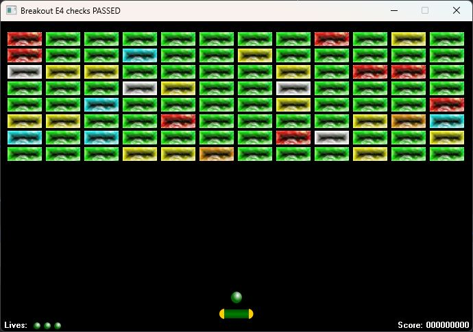

# E4 — Canvas, camadas e feedback visual

Data: 22/10/2026. Base: `2611ded` (E3 integrada). Implementação na branch `codex/e4-canvas`, sem abertura de sessão da Gideon.

## Ajuste após jogar — 23/10/2026

Após avaliar a primeira entrega, Marcos pediu esmaecimento mais curto e contagem mais rápida. `BrickFadeDurationMs` passou de 350 para **250 ms**; `ScoreCountIntervalMs` passou de 20 para **10 ms**, mantendo um ponto por incremento (100 pontos/s: um bloco de 100 em um segundo, de 500 em cinco segundos).

Foi incorporado o balanceamento feito por Marcos em `Breakout.Bricks`: verde **100**, amarelo **150**, ciano **200**, vermelho **250**, prata **400** e ouro **500**. Os testes de valores por classe foram atualizados para essa tabela; os testes temporais passam a verificar o intervalo de 10 ms e a conclusão visual em um segundo para 100 pontos.

Os relatórios abaixo descrevem a entrega original de 22/10. Os ajustes e a validação posterior estão em [evidências de 23/10](evidencias/e4-ajustes-2026-10-23/).

## Resultado

O jogo desenha um quadro completo em um bitmap persistente e o apresenta no Canvas do formulário com uma cópia. Foram retirados os controles de bola, blocos, raquete e HUD. O formulário tem somente `TTimer` e `TApplicationEvents`; a física contínua e o passo fixo de 120 Hz da E3 permanecem intactos.

- `Breakout.Renderer.Vcl`: carrega os sprites uma vez, ajusta o buffer quando necessário, aplica um viewport uniforme e compõe campo → efeitos → raquete/bola → HUD. O Canvas do próprio formulário cumpre a função da superfície única proposta no plano; um `TPaintBox` adicional não traria outra responsabilidade. A pintura opaca trata `WM_ERASEBKGND`, evitando limpar a janela antes de copiar o quadro. Não há segundo buffer da VCL.
- `Breakout.Presentation`: fotografia separada do motor, contagem do placar e efeitos temporários. Pintar não avança o jogo nem as animações. As transições ativo→inativo capturam todos os blocos destruídos, inclusive vários no mesmo callback; o ID do último impacto não é usado como fila de efeitos.
- `Breakout.Bricks`: seis classes com identidade, sprite e pontos explícitos. Verde 100, amarelo 200, ciano 300, vermelho 400, prata 500 e ouro 600. A distribuição e a geração por semente foram preservadas.

O HUD é a camada **1**, desenhada por último com fundo opaco; o campo e seus efeitos são a camada **2**, inferior. O teste cobre sobreposição deliberada de blocos, bola e raquete na faixa de vidas/pontuação e compara os pixels com o HUD livre.

Os streams de bola, vidas, três partes da raquete e atlas dos blocos foram extraídos exatamente do DFM anterior, sem redesenhar os pixels. [Proveniência e hashes](../resources/provenance.json) e [reconstrução do recurso](../resources/README.md). O executável incorpora os recursos: foi executado também com diretório de trabalho fora do repositório.

## Raquete preparada para aumentar

Foi preservada a intenção do `Player` original: um painel com três imagens. No Canvas, as pontas continuam separadas e mantêm sua proporção; somente o centro verde com linhas horizontais se estende. O renderer usa a largura atual de `Snapshot.Paddle`, sem supor largura fixa de 50. A mesma largura é usada pelo motor para centralizar a raquete no mouse e limitar o movimento nas bordas.

Os testes ampliam a largura de 50 para 100: comparam todos os pixels das duas pontas com o tamanho original e verificam as colunas do centro, incluindo emendas. Isso prepara a apresentação para powerups. Coleta, duração, acumulação e regras para aumentar/reduzir a raquete continuam no desejo posterior à E6, registrado no plano.

## Parâmetros para experimentar

Em `src/Breakout.Presentation.pas`:

| Parâmetro | Inicial | Comportamento |
| --- | --- | --- |
| `BrickFadeDurationMs` | 350 ms | Opacidade linear até zero; também testada com 250 e 500 ms. |
| `ScoreCountIntervalMs` | 20 ms | Intervalo visual para cada incremento. |
| `ScoreCountStep` | 1 ponto | O alvo recebe novos acertos enquanto o número exibido sobe. |
| `DebugRefreshSeconds` | 0,2 s | Cerca de cinco atualizações/s do diagnóstico aberto. |

Exemplo coberto: o motor chega imediatamente a 10250 e a apresentação parte de 10150, subindo de um em um durante dois segundos. O bloco deixa de colidir e pontua imediatamente; somente a imagem continua esmaecendo.

Pausa e desativação congelam o tempo visual. A ativação/retomada reinicia a referência do relógio. O delta visual aceita até 100 ms por callback, assim como a política de atraso do loop; uma suspensão longa não dispara uma rajada de pontos. Em Ready após queda, conclusão, vitória e game over, o timer continua enquanto houver animação pendente. F2 limpa efeitos e contagem; outra fase elimina os efeitos da grade anterior, mantendo a dívida do placar.

## Validação

Builds pela IDE Delphi 13 Community Edition, instalação `Studio/37.0`. Os builds finais do jogo passaram depois do ajuste de timer e das métricas. Exemplos: [Win32 Debug](evidencias/e4-2026-10-22/build-win32-debug.png), [Win64 Debug](evidencias/e4-2026-10-22/build-win64-debug.png).

| Plataforma / configuração | Jogo | Console | Resultado do console |
| --- | --- | --- | --- |
| Win32 Debug | Build aprovado | Build aprovado | 191 casos, zero falhas |
| Win32 Release | Build aprovado | Build aprovado | 191 casos, zero falhas |
| Win64 Debug | Build aprovado | Build aprovado | 191 casos, zero falhas |
| Win64 Release | Build aprovado | Build aprovado | 191 casos, zero falhas |

Por configuração: 46 regressões do motor, 104 da física/tempo e 41 da apresentação. Há ainda **47 verificações VCL/bitmap em Win32 Debug**, com zero falhas. [Relatórios JSON](evidencias/e4-2026-10-22/) e [instruções dos executores](../tools/e4/README.md).

A suíte VCL cobre comandos, relógio real, pausa/ativação, ricochetes superior e laterais, vidas, vitória com efeitos pendentes, F1/F2/F10, pintura sem mutação, input com raquete ampliada, camadas, início/metade/fim do esmaecimento e ausência de resíduos. Mil composições consecutivas reutilizam o mesmo buffer; cinquenta reinícios e aberturas/fechamentos do diagnóstico não apresentam crescimento contínuo de GDI/USER após aquecimento.

Foram gerados quadros a 100%, 125%, 150% e 200%, com inversão do mouse e proporção uniforme verificadas. Isso testa a transformação e a rasterização em bitmap; não equivale a trocar o DPI real do Windows ou arrastar entre monitores. Na janela real foram conferidos lançamento por clique, apresentação do placar e restauração do quadro após minimizar. As chamadas automatizadas aos handlers complementam esse ensaio.

Durante a compilação houve F2039 do runner em uso. Foi encerrada a instância e aplicado **Clean somente no BaselineRunner pelo painel Projects**, seguido de Build aprovado. A recarga inicial do Designer foi feita após preservar e comparar os arquivos em memória e em disco; nenhuma alteração de fonte do usuário precisou ser descartada. README local e preferências anteriores dos projetos foram preservados fora do commit.

## Medição e escolha do timer

Três coletas na mesma máquina: E3 compilada antes da troca, E4 com timer de 16 ms e E4 com timer de 15 ms. Cada coleta teve aproximadamente 20 s sem diagnóstico e 20 s com ele. A raquete acompanhou a bola por controlador exclusivo do executor. Os dados brutos e o [resumo reproduzível](evidencias/e4-2026-10-22/comparison.json) ficam nas evidências.

| Medida | E3 | Canvas 16 ms | Canvas 15 ms adotado |
| --- | --- | --- | --- |
| Pinturas/s, sem / com diagnóstico | Não medida | 40,01 / 40,02 | **57,20 / 56,05** |
| p95 do handler, sem / com diagnóstico | 0,969 / 1,122 ms | 0,138 / 0,206 ms | 0,112 / 0,171 ms |
| p95 de composição + apresentação, sem / com diagnóstico | Não medida | 1,917 / 1,831 ms | **1,859 / 1,851 ms** |
| CPU de um núcleo, sem / com diagnóstico | 4,22% / 12,89% | 8,04% / 8,28% | 9,99% / 11,18% |
| GDI no início sem diagnóstico | 155 | 48 | **48** |

O timer de produção passou de 16 para **15 ms** em `UMain.dfm` após esse ensaio. A mediana entre pinturas caiu de aproximadamente 29,9 para 15,1 ms; o p95 ficou próximo de 30,2 ms. O loop continua medindo o tempo real e executando física em passos de 1/120 s. Não foi alterada a resolução global de timers do sistema.

O custo do quadro ficou abaixo da meta de 16,7 ms no p95 amostrado, e a cadência se aproximou de 60 pinturas/s. Há jitter do agendamento: isso não garante 60 FPS constantes nem sincronização com o monitor. O renderer também não implica menor CPU em todos os cenários: a composição completa e a cadência maior elevaram o consumo sem diagnóstico na amostra.

As sementes/partidas diferem entre coletas; o observador e a VCL entram no custo. O handler antigo sincronizava controles; a pintura final ocorria fora dele. Por isso, a queda do custo do handler não é uma medida isolada de aceleração gráfica. `paint.csv` mede efetivamente o início e o custo da pintura atual; o diagnóstico separa simulação, composição, apresentação e intervalo entre pinturas.

O buffer completo, as comparações de pixels e a restauração conferida validam a composição e a repintura nos cenários executados. Uma avaliação humana prolongada de flickering e sessões de dez minutos, além de DPI real/múltiplos monitores, permanece na matriz de consolidação da E6. A comparação Canvas/OpenGL continua como experimento posterior à E6. E5 mantém a progressão finita planejada.
