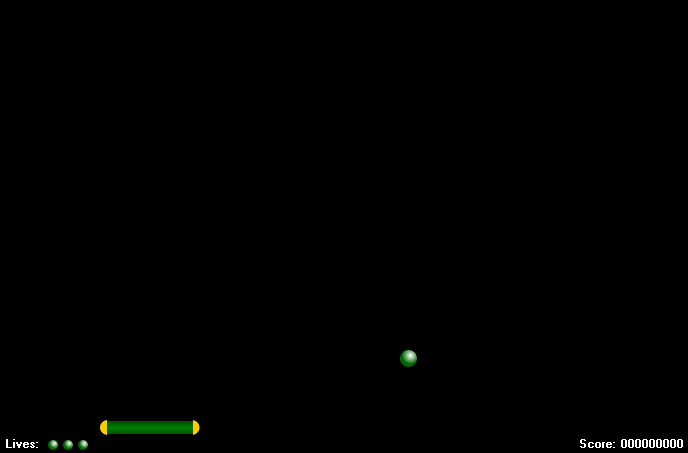

# E4 — Canvas, layers, and visual feedback

Date: 2026-10-22. Base: merged E3 `2611ded`. Branch: codex/e4-canvas; no Gideon session opened.

## Playtesting adjustments — 2026-10-23

Marcos shortened BrickFadeDurationMs from 350 to **250 ms** and reduced ScoreCountIntervalMs from 20 to 10, then **5 ms**, keeping one-point increments. Current rate: **200 points/s**, so 100 points take 0.5 active seconds and 500 take 2.5.

His centralized block rewards are green 100, yellow 150, cyan 200, red 250, silver 400, gold 500. Class-value and temporal expectations follow this table/current interval.

The [first adjustment evidence](evidence/e4-tuning-2026-10-23/README.md) records 250/10 ms. The [documentation/5 ms evidence](evidence/e4-docs-2026-10-23/README.md) records the later verification. Original measurements below retain their original parameters. The [study guide](study/README.md) and [PasDoc API](api/README.md) explain implementation and formulas.

## Result

The game composes a complete frame in a persistent bitmap and copies it once to the form Canvas. Ball/block/paddle/HUD controls are removed; the form contains only TTimer/TApplicationEvents. E3's continuous collision and 120 Hz step remain intact.

- Renderer loads sprites once, resizes only as needed, fits a uniform viewport, and draws field→effects→paddle/ball→HUD. The form Canvas fulfills the proposed single-surface role without an extra TPaintBox. Opaque painting handles WM_ERASEBKGND; there is no second VCL back buffer.
- Presentation owns a detached snapshot, displayed-score debt, and effects. Painting never advances rules/animation. Active→inactive comparisons capture every destroyed block, including multiple hits per callback; last-hit ID is not an effect queue.
- Bricks defines six explicit identities/sprites/rewards. Initial rewards were 100/200/300/400/500/600; current values are listed above. Distribution/seeded generation remain unchanged.

HUD is upper **layer 1**, drawn last with opaque backing; field/effects are lower **layer 2**. Tests deliberately overlap entities with the life/score band and compare pixels against an unobstructed HUD.

Original ball/life/three-paddle-part/brick-atlas streams were extracted byte-for-byte from the prior DFM. See [hashes/provenance](../resources/provenance.json) and [resource rebuild instructions](../resources/README.md). The executable embeds resources and was also run with a working directory outside the repository.

## Paddle prepared for width changes

The original Player panel with three images expressed the intended design. Caps remain separate/proportional; only the green horizontally striped center stretches. Rendering uses current Snapshot.Paddle width, also used for input centering/clamping.

Width-50→100 tests compare every cap pixel and center columns/seams. Collection, duration, stacking, and size-powerup rules remain after E6.

## Parameters and visual clock

| Parameter | Initial E4 | Current | Meaning |
| --- | --- | --- | --- |
| BrickFadeDurationMs | 350 ms | 250 ms | Linear opacity; also tested at 350/500. |
| ScoreCountIntervalMs | 20 ms | 5 ms | Elapsed time per logical increment. |
| ScoreCountStep | 1 point | 1 point | New hits accumulate in the target. |
| DebugRefreshSeconds | 0.2 s | 0.2 s | About five diagnostic refreshes/s. |

The 10150→10250 example takes two active seconds at the initial 20 ms interval and 0.5 at current 5 ms. Rules score/deactivate immediately; only the image fades.

Pause/inactivity freezes visuals; activation/resume resets the clock reference. Visual delta is capped at 100 ms/callback. Ready after loss and terminal states keep scheduling until feedback finishes. F2 clears effects/debt; new levels clear old-board effects and retain score debt.

## Original validation

Builds used Delphi 13 Community Edition Studio/37.0. Final builds followed timer/metric changes: [Win32 Debug](evidence/e4-2026-10-22/build-win32-debug.png), [Win64 Debug](evidence/e4-2026-10-22/build-win64-debug.png).

| Platform/configuration | Main/console build | Console result |
| --- | --- | --- |
| Win32 Debug | Passed | 191 cases, zero failures |
| Win32 Release | Passed | 191 cases, zero failures |
| Win64 Debug | Passed | 191 cases, zero failures |
| Win64 Release | Passed | 191 cases, zero failures |

Each console configuration has 46 engine, 104 physics/time, and 41 presentation cases. Another **47 VCL/bitmap checks** passed Win32 Debug. See [JSON reports](evidence/e4-2026-10-22/) and [runner instructions](../tools/e4/README.md).

VCL checks cover commands, real clock, pause/activation, top/side rebounds, lives, victory with pending effects, F1/F2/F10, read-only painting, wide-paddle input, layers, fade start/half/end, and residue cleanup. A thousand compositions reuse the buffer; fifty restart/debug toggles show no continuous GDI/USER growth after warmup.

Bitmaps at 100/125/150/200% check uniform scale and input inversion, not real Windows DPI or monitor transitions. Live checks covered click launch, score presentation, and repaint after minimizing. Handler fixtures complement them.

An in-use runner F2039 was resolved by closing it and cleaning **only BaselineRunner** through Projects, followed by Build. Initial designer reload followed preservation/comparison of memory/disk files; no user source edits were discarded. At that delivery, local README/project preferences stayed outside the commit; README publication was authorized later.

## Measurements and timer choice

Three collections on the same machine: pre-change E3, Canvas with 16 ms timer, Canvas with 15 ms timer. Each has about twenty seconds without diagnostics, then twenty with it; a runner-only controller tracks the ball. [Raw evidence and reproducible summary](evidence/e4-2026-10-22/comparison.json) are retained.

| Metric, without / with diagnostics | E3 | Canvas 16 ms | Adopted Canvas 15 ms |
| --- | --- | --- | --- |
| Paintings/s | Not measured | 40.01 / 40.02 | **57.20 / 56.05** |
| Handler p95 | 0.969 / 1.122 ms | 0.138 / 0.206 ms | 0.112 / 0.171 ms |
| Composition+presentation p95 | Not measured | 1.917 / 1.831 ms | **1.859 / 1.851 ms** |
| CPU, one core | 4.22% / 12.89% | 8.04% / 8.28% | 9.99% / 11.18% |
| Initial GDI without diagnostics | 155 | 48 | **48** |

Production timer changed from 16 to 15 ms after this trial. Median paint interval fell from about 29.9 to 15.1 ms; p95 was about 30.2 ms. Real elapsed time still drives 1/120 s steps. Global timer resolution was not changed.

Sampled frame cost p95 was below the 16.7 ms target and cadence approached sixty paintings/s. Scheduling jitter remains; this does not guarantee constant 60 FPS or monitor synchronization. Full composition/higher cadence increased sampled CPU without diagnostics.

Seeds/matches differ; observer/VCL costs are included. The old handler synchronized controls while final painting occurred elsewhere, so handler-cost reduction does not isolate graphics acceleration. paint.csv measures actual current paint starts/cost; diagnostics separates simulation/composition/presentation/interval.

Buffer/pixel/restoration checks validate executed composition/repaint scenarios. Prolonged human flicker evaluation, ten-minute sessions, real DPI/multiple monitors remain E6. Canvas/OpenGL comparison remains after E6; E5 retains finite progression.
